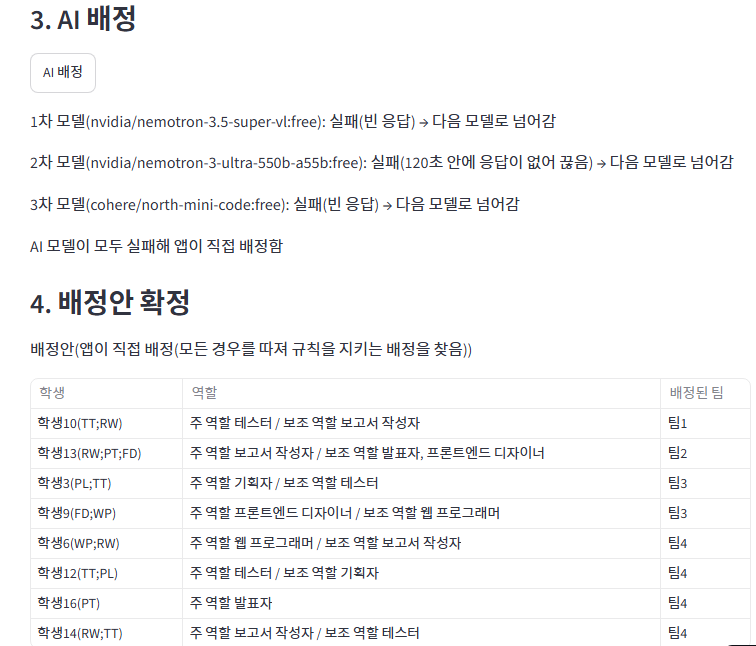

# 팀 프로젝트 팀 편성 웹 앱

데이터과학 미니프로젝트(AI-X) 중간 과제. 작성자: 이승주 (2601965)

## 1. 배포 주소
https://team-formation-kxe26wersaevmzl5dbxbrf.streamlit.app/

## 2. PRD와 구현 계획의 위치
- `docs/PRD.md`
- `docs/구현 계획.md`

## 3. 고른 해결 방법
| 기능 | 고른 해결 |
|---|---|
| 다른 사람의 변경 보기 | 어려운 해결: 학생 화면을 `st.fragment(run_every=3)` 로 3초마다 자동 갱신 (관리자 화면은 새로 고침 단추) |
| 필수 포함 역할을 지킬 수 없는 팀 | 어려운 해결: 지원할 때 남는 자리 수와 못 채운 필수 역할 수를 비교해 막음 |
| 같은 팀에 대기 중인 지원이 여럿 | 어려운 해결: 승인 직전 규칙을 다시 검사, 처리 순서는 투표가 끝난 순서 |
| 마지막 자리에 두 명이 동시에 들어감 | 어려운 해결: `tf_members` 유일성 제약(`schema.sql`) + 트랜잭션 락 |
| AI 응답이 늦을 때 | 어려운 해결: 모델마다 120초 전체 대기 시간을 재서 끊고 다음 모델로 |
| 3차 모델까지 실패 | 어려운 해결: 앱이 모든 경우를 따져 규칙을 지키는 배정을 찾음 |
| AI 대기 중 화면 | 어려운 해결: 몇 차 모델을 기다리는지와 경과 시간을 표시 |
| DB 일시정지 방지 | 어려운 해결: GitHub Actions(`.github/workflows/keepalive.yml`)가 매일 DB에 질의를 보냄 (수동 실행으로 성공 확인) |

## 4. 쓴 모델 3개
1차 `nvidia/nemotron-3.5-super-vl:free`, 2차 `nvidia/nemotron-3-ultra-550b-a55b:free`, 3차 `cohere/north-mini-code:free`

## 5. 오픈라우터 AI 모델 호출 실패 사례
부록 3(어려움) 15단계의 AI 배정에서 세 모델이 모두 실패했고, 앱이 이를 처리해 규칙을 지키는 배정안을 만들었음.
- 1차 모델이 빈 응답을 내서 2차 모델로 넘어감
- 2차 모델이 120초 안에 응답하지 않아 끊고 3차 모델로 넘어감
- 3차 모델도 빈 응답을 내서, 앱이 모든 경우를 따져 직접 배정함. 그 배정안을 확정했고 모든 팀이 규칙을 지켰음



## 6. 클로드가 한 잘못된 추론이나 답변
**사례 1: 파일을 올리는 안내에서 점으로 시작하는 파일이 빠짐.** 클로드가 GitHub 사이트에서 폴더 안의 파일을 끌어다 놓아 올리라고 안내했는데, `.gitignore`와 `.github` 폴더(keepalive 워크플로)가 올라가지 않았음. `.gitignore`는 `.env`를 깃허브에 올리지 않게 막는 파일이라 중요함. 저장소 첫 화면의 파일 목록에 이 두 항목이 없는 것을 보고 알아챘고, 사이트에서 직접 새 파일로 만들어 커밋해서 고쳤음. 근거는 첫 업로드 커밋 `794694d`(Add files via upload)와, 이를 고친 뒤의 커밋 `Add .gitignore file for environment and cache files`, `43b01dc`(Add GitHub Actions workflow for keepalive job)임.

**사례 2: 공고 예시 모델이 이미 무료 목록에서 빠져 있었음.** 클로드가 처음 만든 코드의 기본 모델 1번이 공고에 적힌 `nvidia/nemotron-3-super-120b-a12b:free`였음. 6장 노트(6.2.4.1)를 읽고 이 모델이 2026-10-30에 무료 목록에서 빠져 부르면 404 오류가 난다는 것을 알았고, 저장소에 올리기 전에 `ai.py`와 `.env.example`의 모델 이름을 바꿨음. 그래서 이 사례는 저장소의 커밋 기록이 아니라 6장 노트의 설명이 근거임.

## 7. 내 앱에서 발견한 문제점
**AI 배정이 너무 오래 걸림.** 부록 3(어려움) 15단계에서 AI 배정 단추를 누르고 배정안이 나올 때까지 체감상 약 3분 이상 걸렸음(시간을 직접 재지는 않았음). 2차 모델이 120초를 다 기다린 뒤 끊겼기 때문이며(화면 `img/ai-fail.png`), 무료 모델이 연달아 실패하면 모델마다 최대 120초씩 기다리게 되어 최악의 경우 모델 3개로 6분까지 걸림. 진행 안내(몇 차 모델, 경과 초)는 표시되지만 기다리는 시간 자체가 길어 사용자가 멈춘 것으로 오해하기 쉬움. 개선 방향: 모델마다 대기 시간 제한을 줄이거나(예: 60초), 모델을 동시에 호출해 먼저 규칙 검사를 통과한 답을 쓰도록 바꾸는 것.


---

## 실행 방법
```bash
pip install -r requirements.txt
cp .env.example .env      # 값을 채운다
streamlit run streamlit_app.py
python -m unittest discover -s tests -v   # 규칙 테스트(DB 없이 실행됨)
```
- 학생 비밀번호는 모두 `1234`, 관리자 학번은 `admin`(비밀번호는 `ADMIN_PASSWORD`).
- 연습용 명단은 `data/practice/` 에 있다(가상 학생).
